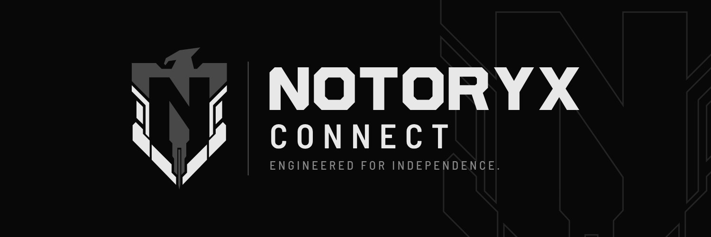
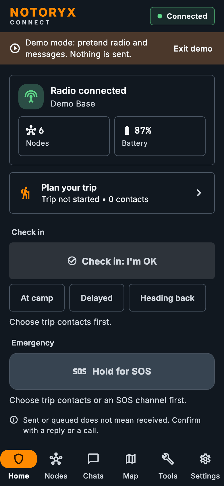
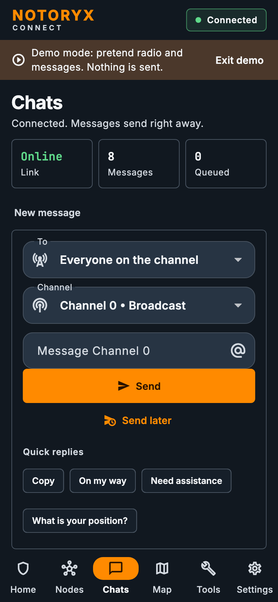
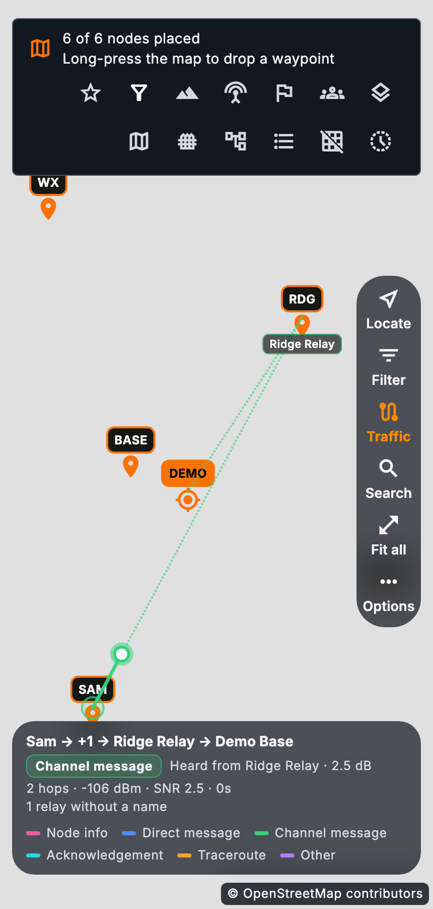
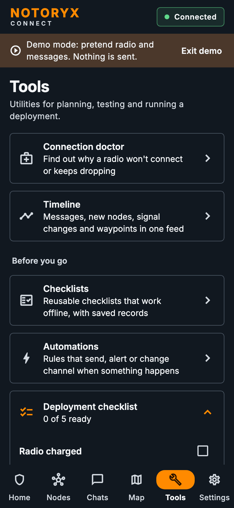
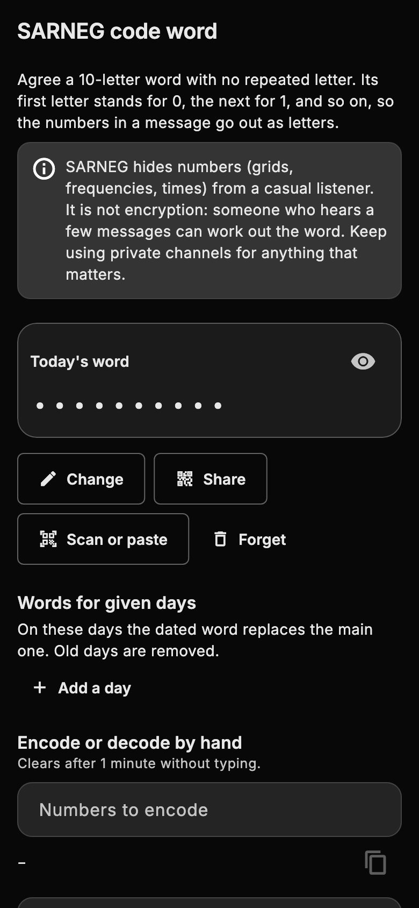
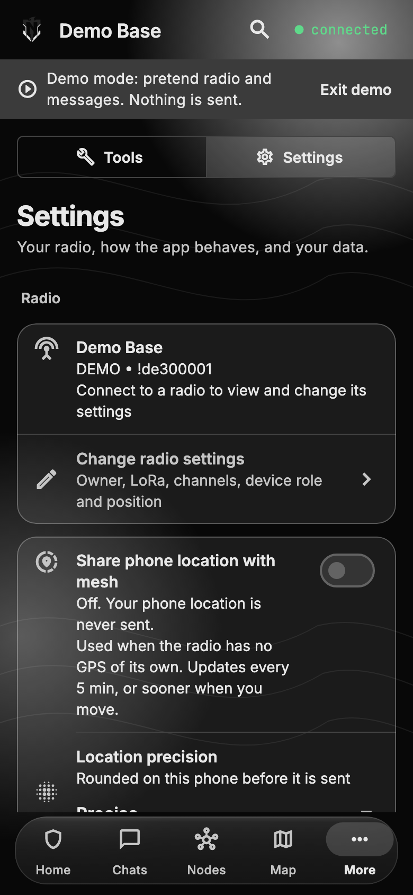
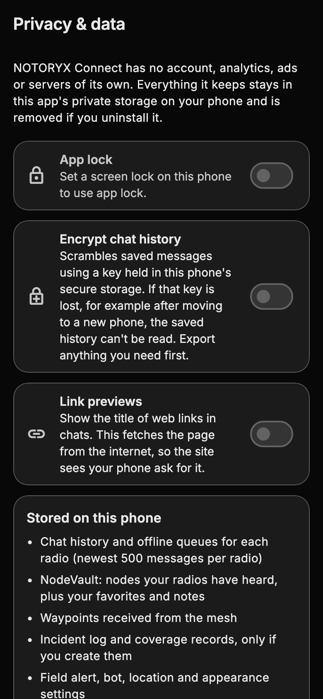
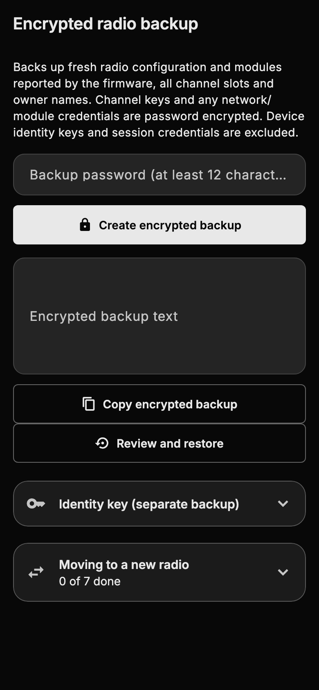
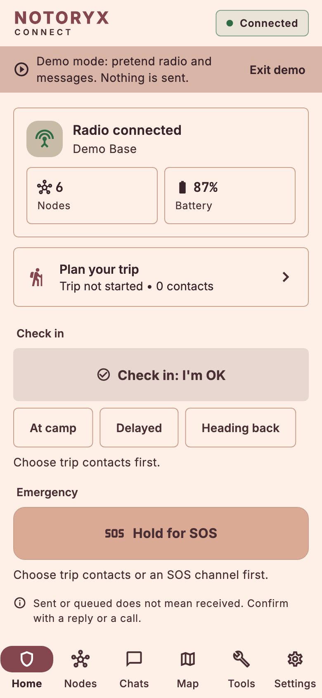

<p align="center">
  
</p>

# NOTORYX Connect

Part of the **NOTORYX** off-grid communications family.

**An independent field app for LoRa mesh radios running Meshtastic® firmware.**

NOTORYX Connect pairs your phone with a radio over Bluetooth, Wi-Fi or USB so you can message, map and manage the mesh without cell service. It interoperates with Meshtastic® firmware while keeping its own name, icon, interface and project identity.

> **Independent project:** NOTORYX Connect (formerly Bastion) is not affiliated with, sponsored by, endorsed by, or an official application of Meshtastic LLC.

<p align="center">
  
  
  
  
</p>
<p align="center">
  
  
  
  
</p>
<p align="center">
  
  
  
  
</p>

<sub>Screenshots show the default BLACKOUT theme (and Bare Beauty, the light theme), rendered from the app's built-in demo mode: a pretend radio and mesh with made-up names, not a live radio. Map tiles need the internet, so the base map is blank in these renders.</sub>

> **Status (2026-11-23):** the latest release is **v1.0.0-beta.46** (version 1.0.0, build 50). It is a test beta. Recent betas were checked on one phone (a Samsung Galaxy A15) with one radio (a Seeed T1000-E running Meshtastic firmware). Drive recording was checked parked on that phone (beta.39) but not yet on a real drive, and its optional two-way check is not yet tested over the air. Many features (USB, Wi-Fi, two-way ATAK, MQTT proxy, remote admin, offline map files, trail routing, SOS relay, Windows and macOS builds) have automated tests but have not yet been checked on a range of phones, radios and firmware versions. Don't rely on it as your only way to call for help. Please [report issues](../../issues).

## Download

Get the latest beta from **[NOTORYX Connect releases](https://github.com/TheLogsAreScreaming/notoryx-connect-releases/releases)**. Betas are marked as pre-releases. Each release lists what changed and includes checksum files for checking your download.

| Platform | File | Notes |
|---|---|---|
| Android (ARM64 phones) | `NOTORYX-Connect-<version>-<build>.apk` | Signed with the release key. Checksums in `SHA256SUMS.txt`, signing details in `SIGNATURE.txt` |
| macOS (Intel and Apple silicon) | `NOTORYX-Connect-<version>-<build>-macOS-universal.zip` | Not notarized: right-click the app and choose **Open** the first time |
| Windows (64-bit) | `NOTORYX-Connect-<version>-<build>-Windows-x64-setup.exe` or `-Windows-x64.zip` | Installs for your user, no admin needed. Not code signed, so SmartScreen warns on first launch |
| Google Play | `NOTORYX-Connect-<version>-<build>.aab` | For the Play Console, not for installing directly |

iOS is built in CI (unsigned) but isn't released. App Store distribution waits on an Apple developer account and a GPL licensing question; see [docs/APP-STORE.md](docs/APP-STORE.md).

### Install on Android

1. On your phone, open the release and download the `.apk`.
2. Open the file. If Android asks, allow installs from your browser or file manager.
3. Open NOTORYX Connect and allow **Bluetooth**, **location** and **notifications** when asked.
4. For a steady background link, set the app's battery use to **Unrestricted** (**More → Settings → Background connection** shows how).

Newer betas install over older ones and keep your data. Don't uninstall first.

**Upgrading from v0.1.3-beta.1 or earlier:** the app ID changed from `org.backcountrysignal.bastion` to `com.bastionmesh.connect`, so the new app installs separately instead of updating the old one. Make a backup in the old app (**More → Settings → Phone data backup / restore**), install the new app, restore the backup there, then uninstall the old app. You only do this once.

## Getting started

The app has five tabs: **Home**, **Chats**, **Nodes**, **Map** and **More**. **More** holds **Tools** and **Settings**.

1. **No radio yet?** On **Home**, tap **Try the demo** to explore the app with a pretend radio and mesh. Nothing is sent and your own data is left alone.
2. **Connect your radio.** On **Home**, tap **Connect radio**, or on **Nodes**, scan and tap **Connect**. Bluetooth, Wi-Fi (TCP port 4403) and USB (OTG cable) are supported. NOTORYX Connect checks the Meshtastic service, runs the PhoneAPI handshake and syncs the node list before it marks the session ready, and reconnects on its own if the link drops. If something goes wrong, **More → Tools → Connection doctor** walks through the likely causes.
3. **Send a message.** On **Chats**, pick a channel or a node and send. Messages typed while you're offline are queued and sent when the radio is back.
4. **Check your radio's settings.** **More → Settings → Change radio settings** shows the node's identity, LoRa settings, channels and modules. Every change is read back from the radio to confirm it saved.
5. **Plan your trip.** On **Home**, add up to 6 trip contacts and run **Trip readiness**. **Check in** sends them your status, position and battery, and **Hold for SOS** repeats a call for help until one of them answers.

## Features

### Trip safety
- **Field console** with radio status, node count and battery, plus a home-screen widget and a Quick Settings tile.
- **Plan your trip:** up to 6 trip contacts, an overdue alert, a check-in reminder, and a trip plan you can share.
- **Trip readiness** check before you leave: radio, battery, firmware, channels, SOS channel, position, background limits and when each trip contact was last heard.
- **Check in** with one tap (I'm OK, At camp, Delayed, Heading back). It goes to every trip contact as a direct message with time, position and battery, and the **check-in delivery map** shows who it reached.
- **Hold for SOS** sends to your trip contacts and optionally a channel, repeats while respecting the channel's airtime, stops when a contact answers, and **I'm safe** sends an all-clear.
- **SOS relay** (off by default): when a NOTORYX SOS on a channel reaches you with no hops left, or your radio is set not to rebroadcast, your radio passes it on once.
- **Team setup:** channels, radio settings and trip contacts in one QR code, so a group is ready in one scan.
- **Track log:** record where you go, export it as GPX, and get a warning when you stray from it.
- **Team view:** each trip contact's freshness, distance, direction and battery, 24-hour trails, **day replay** of team positions, **zone alerts** when people arrive or leave, and **off-route alerts**.

### Messaging
- Channel and direct messages with delivery receipts that say whether the radio proved delivery, and hop count, signal and relay on each message.
- Offline queue, **forward** and **send later**, a draft kept for each conversation, and an airtime estimate while you type.
- Emoji reactions (tap a message), replies, @mentions, pinned messages, unread markers and date dividers.
- Search across all saved messages. Chat history is kept in an on-phone database, separately for each radio, and can be **encrypted**.
- Reply from the notification. **Ignore** or **mute** nodes, hide words you choose, and get a warning when a node's name looks like another's. An SOS reply from a trip contact is never missed.
- **SALUTE** and **9-Line** report forms, check-in and assistance templates, and **Bot Mode** with quiet hours, rate limits and loop protection.
- **SARNEG code words** (More → Tools → SARNEG code word): send grid references, frequencies and times as letters instead of digits. Your team agrees on a 10-letter word with no repeated letter (with BLACKHORSE, `[SARNEG] LRs KSAC` reads as 17S 4823); the app warns when you pick a widely published word like that one. A SARNEG button in the message box codes the numbers before you press Send, and a received `[SARNEG]` message gets a tap-to-decode line. Share the word by QR code or text, and set a different word for given days. The word stays hidden until you tap to show it, the hand encoder and the clipboard clear themselves after a minute, and Android blocks screenshots of the SARNEG screen. The same format works in every NOTORYX app that has SARNEG. It keeps numbers away from a casual listener; it is **not encryption**.
- Optional **community moderation** (off by default): report spam, see a Flagged label on banned nodes, and appeal a ban on your own node.

### Nodes and maps
- **App-wide search** from every tab: nodes (by name or node ID), channels, messages, saved places and settings.
- Nodes grouped by when they were heard, with distance, hops, battery and signal on each row, a **stale** badge for quiet nodes, and **import nodes** from a Meshtastic app node database export (imported nodes show in the list and the Home count).
- Sensor readings from nodes that report them, with **Request sensors** on a node; **Battery watch** lists every node that reports its battery, the most worrying first.
- **Live Traffic map** that animates heard packets hop by hop, **range rings** around your radio, and one shared pin for nodes at the same spot.
- **NodeVault:** every node your radios have heard, with favorites, a favorites-only filter, a **node journal** (notes and tags), telemetry charts, signal history, neighbors and node-key change alerts.
- **Traceroute** with SNR for each hop, shown on the map, plus a **network diagram** and **mesh health** (channel use and airtime).
- Map with node positions, waypoints, rally points and routes, a coverage heatmap, and nodes your radio has forgotten. The map can also be read as a list for screen readers.
- **Place search**, a **topo map** and a line-of-sight **link planner** (Open-Meteo elevation).
- **Trail routing:** plan walking routes with no signal, over trails you download beforehand from OpenStreetMap (the download sends the area's bounds to the Overpass service).
- **Map layers** from GPX, KML or GeoJSON, **offline maps** from an MBTiles file, and GPX export of waypoints and trails. OpenStreetMap areas you've viewed stay cached offline.
- **Mesh beacons** (which can carry a Plus Code) and **local mesh discovery**.
- Opt-in phone GPS sharing, with position precision set for each channel.

### Radio management
- Connect over **Bluetooth**, **Wi-Fi** or **USB**, with a firmware version check, saved radios and a Disconnect button.
- Every config section and module can be edited through a generated form. Settings the radio can't use are greyed out with the reason, and every save is verified with a fresh read from the same radio.
- **Remote admin** of other nodes you hold the admin key for.
- Share and import channels as `meshtastic.org/e/#` links or QR codes.
- **Encrypted radio settings backup** (AES-256-GCM, PBKDF2 with 600,000 iterations), identity key backup, and a checklist for moving to a new radio.

### Field tools and integrations
- Incident log, range test, store-and-forward catch-up and CSV export.
- Drive recording: a live map of where the mesh reaches as you drive (100 m or 300 m squares), direct and relayed readings kept apart, GPS that keeps running with the screen off, saved drives, exports (GPX, KML, CSV, GeoJSON, drive file; first and last 500 m left out by default) and an optional two-way check that's off by default.
- **Mesh activity:** field stats, network changes and a live packet log. **Antenna hunt:** clicks speed up as one node's signal gets stronger, for aiming an antenna or finding a spot (listen-only, with an optional traceroute).
- **Field guide** and troubleshooting guides: mesh basics, batteries in the cold, solar and antennas.
- Deployment checklist, offline checklists, battery runtime estimate and an RSSI field reference.
- **Timeline** of messages, new nodes, signal changes and waypoints in one feed, and **automations**: rules that send a message, alert you or change channel when something happens.
- Local alerts on the phone: low battery, new nodes, favorites going quiet, and changes in the mesh.
- **Two-way ATAK** (asks before sharing positions) with map markers, and an **MQTT client proxy**.
- Low-power field mode and a background connection service on Android.

### Privacy, backups and look
- No account, no analytics, no ads and no NOTORYX servers. **More → Settings → Privacy & data** lists what's stored and sent, and can delete chat history or all phone data.
- Optional **app lock**, and an **encrypted phone data backup** of chats, NodeVault, waypoints, field records and settings.
- Five themes: **BLACKOUT** (the default: matte black, charcoal, steel and frost, with color kept only for status like good signal, warnings and SOS), Blaze, Bare Beauty (light), Okabe-Ito (color-blind safe) and Night Ops (dim reds for low light). An optional second theme for when the phone is in dark mode, and a custom background. Glass cards, Inter type, and side tabs on tablets.
- In English, Spanish, French and German (follows the phone language; translations are unreviewed). Layouts hold up with large text and screen readers ([accessibility audit](docs/ACCESSIBILITY_AUDIT.md)).

## Safety

NOTORYX Connect may support field and emergency-communications workflows, but software and mesh radio links are not guaranteed emergency lifelines. Keep backup communications and a safety plan suited to where you're going.

## Building from source

Requirements: Flutter 3.47.7, Java 17 and the Android SDK.

```sh
flutter create --no-pub --platforms=android --org com.bastionmesh --project-name bastion .
git checkout -- pubspec.lock   # flutter create replaces it with a template
python3 scripts/prepare_android.py
flutter pub get --enforce-lockfile
dart run flutter_launcher_icons
flutter analyze
flutter test
flutter run
```

CI generates the Android project with the Dart project name `bastion` and organization `com.bastionmesh`. `scripts/prepare_android.py` then sets the application ID to `com.bastionmesh.connect` and adds the Bluetooth, location and notification permissions.

Dependency versions are locked in the committed `pubspec.lock`, and CI runs `flutter pub get --enforce-lockfile`, so every build uses the same packages. To change a dependency, edit `pubspec.yaml`, run plain `flutter pub get`, and commit the updated `pubspec.lock`.

The README screenshots (the main tabs in the BLACKOUT and Bare Beauty themes, plus the SARNEG, trip, beacons, discovery, field records, privacy and backup screens and the Traffic map) are rendered by `test/preview/screens_preview_test.dart` with the app's own fonts and the demo radio:

```sh
PREVIEW_OUT=docs/screenshots flutter test test/preview
```

### macOS, Windows and iOS

The **NOTORYX macOS Build** workflow generates the macOS project, applies `scripts/prepare_macos.py` (app name, Bluetooth/camera/location prompts, sandbox entitlements, Impeller off for Intel Macs) and builds a universal Intel + Apple silicon `NOTORYX Connect.app`, zipped as `NOTORYX-Connect-<version>-macOS-universal.zip`. It is ad-hoc signed, not notarized: on first launch, right-click the app and choose **Open**. Android-only features (background connection service, notifications) are inactive on macOS. Bundle ID `com.bastionmesh.connect` is separate from NOTORYX Core (`com.bastionmesh.bastion`), so both apps can be installed side by side.

The **NOTORYX Windows Build** workflow builds a 64-bit Windows app as a per-user installer and a zip. The **NOTORYX iOS Build** workflow builds an unsigned iOS app to check that it compiles; **NOTORYX iOS TestFlight** is ready for when an Apple developer account is set up ([docs/APP-STORE.md](docs/APP-STORE.md)).

### Build validation and releases

Pull requests and pushes run the **NOTORYX Android CI** workflow (Flutter analysis, tests, an ARM64 release APK build and a retained APK artifact) alongside the macOS, Windows and iOS builds. Signed candidates are built by the manual **NOTORYX Signed Release Candidate** workflow from main and published by hand to [notoryx-connect-releases](https://github.com/TheLogsAreScreaming/notoryx-connect-releases/releases). A build isn't production-ready until hardware testing, release signing, dependency and license review, privacy review and release QA are done. See [release readiness](docs/RELEASE-READINESS.md), the [device test checklist](docs/DEVICE-TEST-CHECKLIST.md) and [branch/PR triage](docs/BRANCH-AND-PR-TRIAGE.md).

## App icon and artwork

The NOTORYX Connect icon artwork is in `branding/`:

| File | Use |
|---|---|
| `notoryx-icon.png` | Full square icon (1024 px): older Android launchers, iPhone and this README |
| `notoryx-icon-foreground.png` | Android adaptive icon foreground: the emblem on transparency, inside the safe zone |
| `notoryx-icon-background.png` | Android adaptive icon background |
| `notoryx-icon-monochrome.png` | Android 13+ themed (monochrome) icon |
| `notoryx-icon-macos.png` | macOS app icon (rounded tile, 1024 px) |
| `notoryx-icon.ico` | Windows app icon (16–256 px) |
| `notoryx-connect-banner.png` | Banner at the top of this README |

These come from the NOTORYX BLACKOUT brand kit (Connect set). Play Store graphics (512 px icon, 1024 × 500 feature graphic) are in `fastlane/metadata/android/en-US/images/`, and the in-app header mark is `assets/images/notoryx_logo.png`.

The icon and NOTORYX Connect visual identity are independent artwork and must not incorporate the official Meshtastic logo unless a future use is separately authorized and complies with the then-current trademark rules.

## Compatibility

NOTORYX Connect implements interoperability with the public protocol used by Meshtastic® firmware. Technical references to Meshtastic® in source code and documentation describe compatibility or protocol behavior; they are not NOTORYX Connect product branding.

NOTORYX Connect does not use “Meshtastic” in its primary or secondary software product name. The official Meshtastic logo is not used as the NOTORYX Connect application icon or primary branding.

## Trademark and licensing notice

Meshtastic® is a registered trademark of Meshtastic LLC. Meshtastic software components are released under various licenses; see GitHub for details. No warranty is provided. Use at your own risk.

NOTORYX Connect is independently developed and is not affiliated with, sponsored by, or endorsed by Meshtastic LLC. All Meshtastic® trademarks remain the property of Meshtastic LLC.

Official policy and project information:

- Licensing and trademark rules: https://meshtastic.org/docs/legal/licensing-and-trademark/
- Official website: https://meshtastic.org/
- Official GitHub organization: https://github.com/meshtastic

See [TRADEMARKS.md](TRADEMARKS.md) for NOTORYX Connect's trademark-use rules.

## Upstream software and third-party licenses

Meshtastic software components are released under various licenses. NOTORYX Connect must preserve all applicable license notices, attribution, source-distribution obligations, and other requirements for any upstream component that is actually incorporated into the project.

NOTORYX Connect includes generated protocol bindings from `meshtastic/protobufs` v2.8.2. Its GPL-3.0 license text is preserved in `licenses/meshtastic-protobufs-GPL-3.0.txt`. NOTORYX Connect is licensed under GPL-3.0; see [LICENSE](LICENSE). Keep the generated-code and third-party notices with distributed builds.

Third-party Flutter/Dart dependencies remain subject to their respective licenses.

## Contributing

Testing, bug reports, hardware compatibility reports and feature ideas are welcome. Contributions must preserve NOTORYX Connect's independent branding and comply with [TRADEMARKS.md](TRADEMARKS.md) and all applicable third-party licenses.
